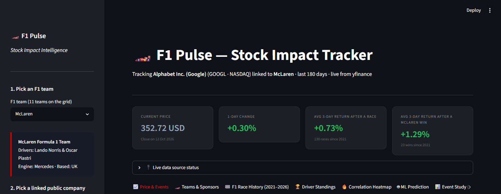
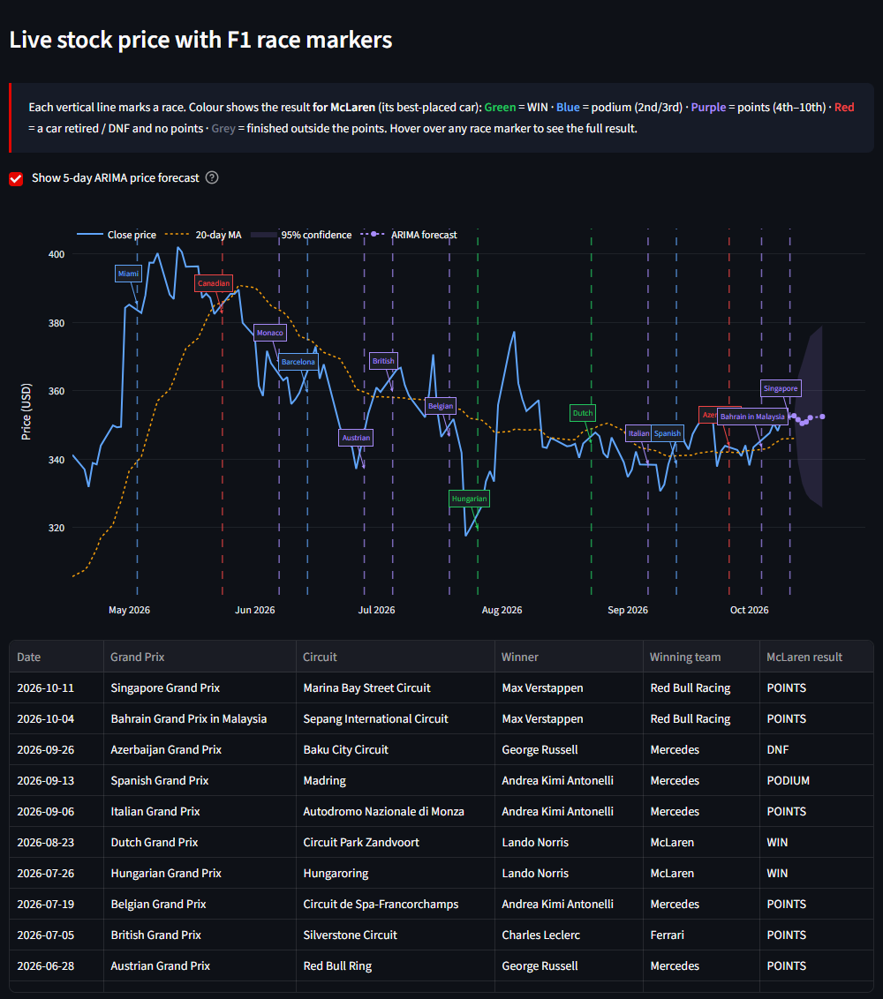
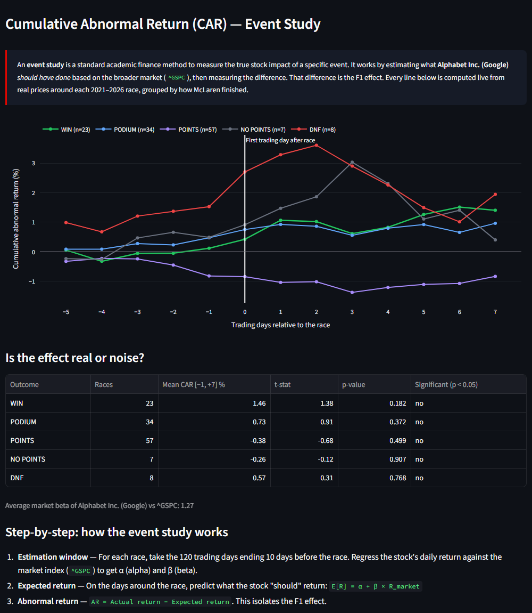
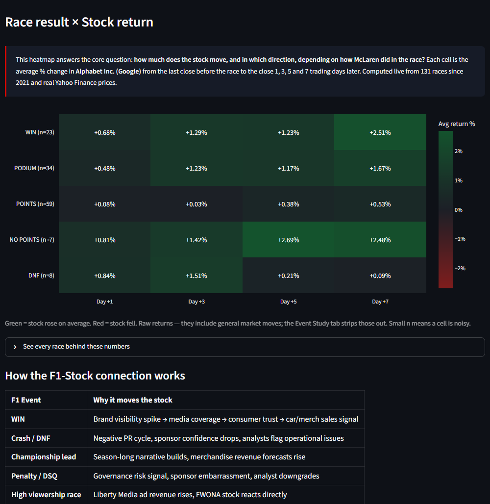
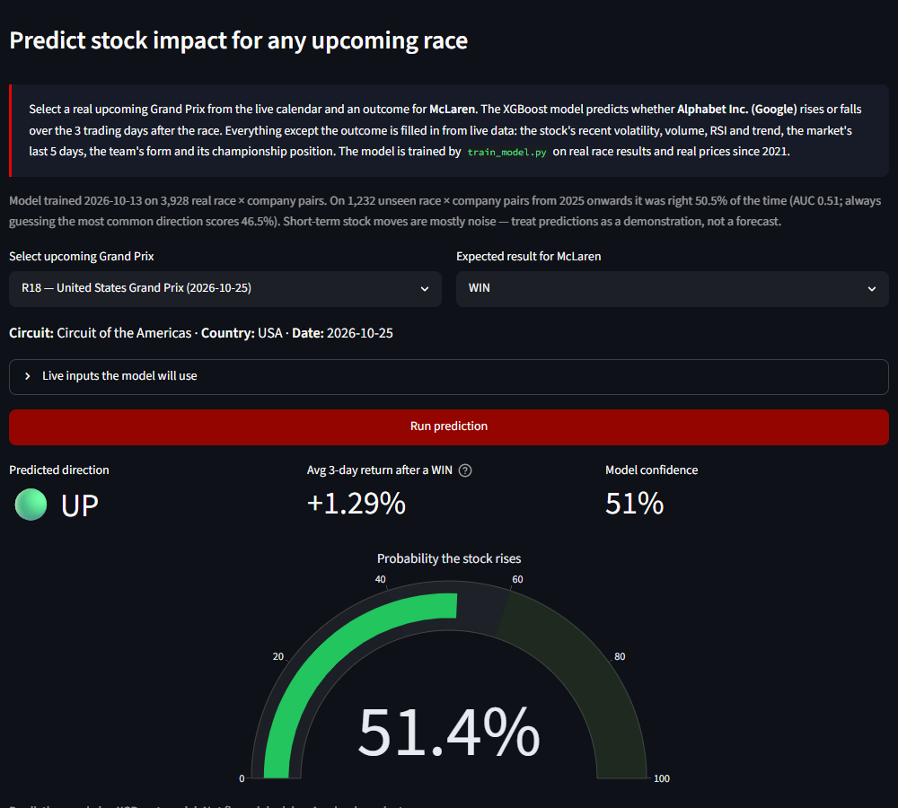

# 🏎️ F1 Pulse — Stock Impact Intelligence

> A live data science web app that analyses and predicts how Formula 1 race events affect the stock prices of publicly-traded companies linked to the sport.

**🔗 Live Demo:** [F1 Pulse — Live App](https://f1-pulse-bupdkceywredqjhab5vn2y.streamlit.app/)




---

## What This Project Does

Formula 1 is uniquely connected to the global stock market. Ferrari (NYSE: RACE) is simultaneously a car manufacturer and an F1 team. Liberty Media owns F1 itself (NASDAQ: FWONA). When Ferrari wins at Monza, analysts notice. When Red Bull is penalised for a budget cap violation, their sponsors react.

**F1 Pulse tests one specific hypothesis:**
> *Can Formula 1 race outcomes — wins, crashes, championship changes — measurably predict short-term stock price movements in companies linked to the sport?*

The app answers this across three layers:

| Layer | Question | Method |
|-------|----------|--------|
| **Descriptive** | Does a relationship exist? | Price chart + event markers |
| **Statistical** | How significant is it? | Event study (CAR) + t-test |
| **Predictive** | Can we forecast it? | XGBoost classifier on real race × price data (+ ARIMA baseline) |

---

## Key Findings

Measured on **131 races (March 2021 – October 2026)** with real Yahoo Finance prices, each stock compared against its home market index:

| Team → stock | Mean CAR [−1, +7] after a race, by the team's result |
|---|---|
| Ferrari → RACE (vs S&P 500) | WIN −1.31% (n=12, p=0.24) · PODIUM +0.17% (n=50, p=0.77) · DNF +0.66% (n=6, p=0.63) |
| Mercedes → MBG.DE (vs DAX) | WIN −1.36% (n=27, p=0.07) · PODIUM −0.14% (n=47, p=0.83) |
| Aston Martin → AML.L (vs FTSE 100) | PODIUM +1.82% (n=9, p=0.64) · DNF −0.22% (n=24, p=0.90) |
| Alpine → RNO.PA (vs CAC 40) | PODIUM −2.30% (n=4, p=0.42) · DNF +0.53% (n=19, p=0.72) |
| Audi → VOW3.DE (vs DAX) | DNF +0.43% (n=24, p=0.71) |
| Cadillac → GM (vs S&P 500) | DNF +1.34% (n=10, p=0.58) |

1. **No race result produces a statistically significant abnormal return** for any team's parent company (all p > 0.05). The popular claim that "Ferrari stock rises ~1.8% after a win" is not supported — the measured effect is −1.3% and indistinguishable from noise.
2. **The ML model confirms it.** Trained on 2021–2024 and tested on 1,232 race × company pairs from 2025–2026 it never saw, it is right 50.5% of the time (AUC 0.51) — a coin flip. Race results carry no usable short-term trading signal.
3. **Why:** these are large, diversified companies worth tens of billions; a single Sunday result is tiny next to earnings, macro news and market moves, and race outcomes are largely anticipated from qualifying and form.

A null result, measured properly, is still a result: it shows the pipeline — event study, significance testing, time-based validation — doing its job instead of finding patterns in noise. *(Numbers update live in the app as new races are run.)*

| Price & race markers + ARIMA forecast | Event study (CAR) |
|---|---|
|  |  |
| **Result × return heatmap** | **ML prediction** |
|  |  |

---

## Live Features

- **Price & Events** — Live stock price chart with F1 race results overlaid as markers, plus a 5-day ARIMA forecast with 95% confidence band. Hover over any race marker to see the event details.
- **Teams & Sponsors** — All 11 F1 teams (2026 grid), their publicly-traded parent companies, title sponsors, and engine suppliers — mapped to verified stock tickers across 12 global exchanges.
- **F1 Race History** — Complete race results from 2021–2026, filterable by season and team, with win statistics and podium breakdowns.
- ** Driver Standings** — Championship points table and multi-season comparison chart for all 22 drivers.
- **Correlation Heatmap** — Average stock returns computed live from real prices, grouped by the selected team's result (WIN, PODIUM, POINTS, NO POINTS, DNF), Day +1 to Day +7 after each race since 2021.
- **ML Prediction** — Pick any upcoming Grand Prix from the live calendar and a result for the team; the model predicts whether the linked stock moves UP or DOWN over the next 3 trading days, using live stock, market and championship inputs.
- **News Sentiment** — VADER sentiment of the last 7 days of headlines about the selected team via NewsAPI (needs a free API key).
- **Event Study (CAR)** — Academic-grade Cumulative Abnormal Return analysis with t-test statistical significance.

---

## Architecture

```
f1-pulse/
├── app.py                        # Main Streamlit dashboard (7 tabs)
├── train_model.py                # Offline model training script
├── requirements.txt
├── models/
│   ├── predictor.py              # Loads the model, makes predictions, ARIMA baseline
│   ├── xgb_model.json            # Trained XGBoost model (portable JSON format)
│   └── model_meta.json           # Training date, sample size, test accuracy
├── data/f1_seasons/              # Finished seasons shipped with the app (fast first load)
├── tests/                        # pytest suite, runs offline; CI on every push
└── utils/
    ├── data_fetcher.py           # Live F1 results (Jolpica → FastF1 → cache) + yfinance
    ├── event_study.py           # Post-race returns + market-model event study
    ├── ml_features.py           # Pre-race features for the ML model
    ├── teams_sponsors.py        # 11 teams, 37 companies, verified tickers
    ├── f1_data.py               # Offline fallback copy of results + standings
    └── sentiment.py             # NewsAPI + VADER NLP
```

---

## Technical Methodology

### Data Pipeline
- **Stock prices** — `yfinance` (Yahoo Finance), daily OHLCV, primary exchange listings
- **F1 race results** — Live from the Jolpica F1 API (every race since 2021, refreshed every 30 minutes), FastF1 as backup, bundled copy only if both are offline
- **News sentiment** — NewsAPI headlines, VADER sentiment scoring
- **Market index** — each stock is compared with its home index (S&P 500, DAX, FTSE 100, CAC 40, FTSE MIB, …)

### Feature Engineering
For each race, `utils/ml_features.py` computes only what was known before the race:
- `event_score` — the team's result: WIN=3, PODIUM=2, POINTS=1, NO POINTS=0, DNF=-1
- `pre_event_volatility` — standard deviation of the last 10 daily returns
- `volume_spike` — last pre-race volume vs its 20-day average
- `rsi_at_event` — 14-day RSI at the last pre-race close
- `above_ma20` — whether the price is above its 20-day average
- `market_trend_5d` — the home market index's return over the 5 days before the race
- `team_form` — share of the team's last 5 races finished on the podium
- `champ_pos` — the team's constructor-championship position going into the race
- `season_progress` — round ÷ rounds in the season
- Target: did the stock rise over the 3 trading days after the race?

### Machine Learning
- **XGBoost classifier** — predicts stock direction (UP/DOWN) after upcoming races
- **Training data** — ~3,900 real race × company pairs (every team–sponsor link, every race since 2021)
- **Time-based test** — trained on 2021–2024, tested on 2025–2026 races it never saw: **50.5% accuracy, AUC 0.51** (always guessing the most common direction: 46.5%). Short-term moves after a race are close to unpredictable — a result in line with the event study below.
- **ARIMA(2,1,2)** — time series baseline for 5-day price forecasting (`arima_forecast` in `predictor.py`)

### Event Study (Academic Finance Method)
1. **Estimation window** — 120 trading days before each race (days -130 to -10)
2. **Expected return** — market model `E[R] = α + β × R_market`, fitted on the estimation window
3. **Abnormal return** — `AR = Actual return − Expected return`
4. **CAR** — cumulative sum of ARs from Day −5 to Day +7 (significance table uses Day −1 to +7)
5. **T-test** — one-sample t-test of each result group's CAR against zero (p < 0.05 threshold)

---

## Companies & Exchanges Tracked

| Category | Examples | Exchanges |
|----------|---------|-----------|
| Team manufacturers | Ferrari (RACE), Mercedes-Benz (MBG.DE), VW/Audi (VOW3.DE), GM/Cadillac (GM) | NYSE, XETRA |
| Title sponsors | Oracle (ORCL), HP (HPQ), Atlassian (TEAM), Visa (V), Google (GOOGL) | NYSE, NASDAQ |
| Engine partners | Honda (HMC), Ford (F) | NYSE |
| F1 ownership | Liberty Media (FWONA) | NASDAQ |
| Tyre supplier | Pirelli (PIRC.MI) | Borsa Italiana |
| Global sponsors | LVMH (MC.PA), PepsiCo (PEP), Salesforce (CRM), AWS (AMZN) | EURONEXT, NASDAQ |
| Betting partners | Flutter/FanDuel (FLUT) | NYSE |

**37 verified public companies · 12 global exchanges · 11 countries**

> All tickers use each company's **primary exchange listing** — not US OTC ADRs — for accurate, liquid pricing.

---

## Run Locally

### Prerequisites
- Python 3.10+
- Git

### Setup

```bash
# Clone the repository
git clone https://github.com/KritikaDadhich/f1-pulse.git
cd f1-pulse

# Create and activate virtual environment
python -m venv venv
venv\Scripts\activate        # Windows
# source venv/bin/activate   # Mac/Linux

# Install dependencies
pip install -r requirements.txt

# (Optional) Retrain the ML model on the latest data — updates models/xgb_model.json
python train_model.py

# Run the app
streamlit run app.py

# Run the tests (offline — no API calls)
pip install -r requirements-dev.txt
pytest
```

Open `http://localhost:8501` in your browser.

### Optional: Add NewsAPI key for real sentiment data
1. Get a free key at [newsapi.org](https://newsapi.org) (no credit card)
2. Create `.streamlit/secrets.toml` (or add the same line to a `.env` file). On Streamlit Cloud, paste it under **App settings → Secrets**:
```toml
NEWSAPI_KEY = "your_key_here"
```

---

## Academic Context

This project was built as part of a **Master of Data Science** at **RMIT University** (2025–2026). It directly applies coursework from:

| Subject | Application in this project |
|---------|----------------------------|
| Practical Data Science with Python | Full pipeline: `app.py`, all utils |
| Data Wrangling using R → Python | `data_fetcher.py`, `ml_features.py` merge logic |
| Advanced Programming with Data Science | XGBoost pipeline, scikit-learn |
| Time Series & Forecasting using R | ARIMA baseline in `predictor.py`, event study |
| Data Visualisation using R → Plotly | All 7 dashboard tabs |
| Applied Analytics | Event study, CAR methodology |
| Data Mining using Weka → XGBoost | Classification model training |
| Cloud Computing (AWS) | Architecture designed for Lambda/S3 |

---

## Future Roadmap

- [ ] AWS Lambda function for daily automated data refresh
- [ ] DynamoDB storage for prediction tracking and accuracy logging
- [ ] Multivariate regression across multiple stocks simultaneously
- [ ] Real-time race weekend alerts via email/SMS
- [ ] Expand to MotoGP and NASCAR (same methodology, different companies)
- [ ] Portfolio simulator: "what if you bought Ferrari stock before every win?"

---

## Disclaimer

This project is built for academic and educational purposes only. Nothing in this app constitutes financial advice. All stock data is sourced from public APIs with standard delays. Past F1-stock correlations do not guarantee future returns.

---

## Author

**Kritika Dadhich**
Master of Data Science · RMIT University · Melbourne, Australia

[](https://www.linkedin.com/in/kritikadadhich)
[](https://github.com/KritikaDadhich)

---

*Built with Streamlit · Plotly · XGBoost · yfinance · VADER NLP*
